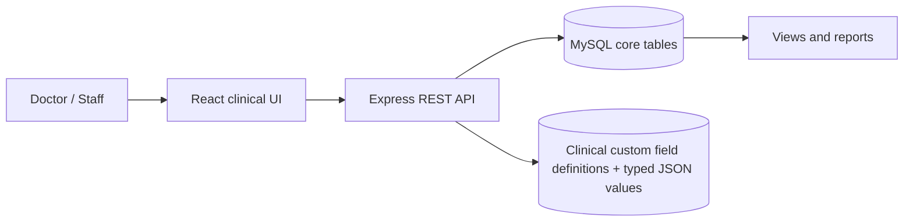
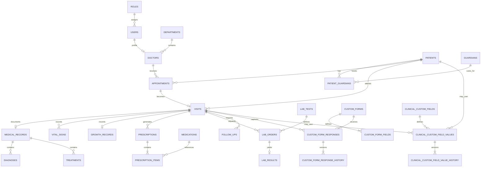

# System Design

## Architecture

The relational core stores stable facts such as patients, appointments, visits and prescriptions. Dynamic forms store definitions separately from answers, so a new clinical question does not require an `ALTER TABLE`.

## ER model

## Normalization

- **1NF:** values are atomic; repeating medications, guardians, diagnoses and options are separate rows.
- **2NF:** junction-table attributes describe the full relationship. For example, `relationship` belongs to the patient-guardian pair.
- **3NF:** department, user, medication and lab-test facts live once and are referenced by keys. Derived BMI is an explicit generated value based solely on measurements.
- **Controlled exception:** dynamic definitions keep options and validation rules as JSON. Stable clinical facts remain normalized. The active clinical-field API validates typed JSON values against their field definitions and records revision history. The separate questionnaire tables remain available for database evaluation.

## Two dynamic-data patterns

The schema contains two related patterns. The database evaluation tables headed by `custom_forms` demonstrate versioned questionnaires and visit-linked JSON response objects; the current website does not expose a questionnaire builder. The website uses `clinical_custom_fields` to extend clinical screens with individually defined columns. Each definition is scoped to a context (`patient`, `visit`, `prescription`, `lab_order`, `allergy`, `immunization` or `follow_up`), while `clinical_custom_field_values` stores a typed JSON value against exactly one matching clinical record.

The value table has nullable foreign keys for the supported record types plus a `CHECK` requiring exactly one owner. Insert/update triggers verify that the populated owner column matches the definition's context. The API validates required values, numeric ranges, text length and allowed dropdown/checkbox options. Value revisions are copied to `clinical_custom_field_value_history`. Removing a definition is a soft retirement, so historical values are not destroyed.

Patient-scoped fields carry forward across visits. Visit-scoped fields stay specific to the encounter. Prescription, laboratory, allergy, immunization and follow-up fields remain attached to their corresponding records. This prevents an improvised field on one screen from leaking into an unrelated clinical entity.

## Integrity and concurrency

Foreign keys prevent orphans; unique keys prevent duplicate MRNs and duplicate form responses per visit/template version; checks reject malformed JSON, impossible ranges and reversed dates. Clinical records use recoverable soft deletion with actor and reason metadata. Audit trails, response history and follow-up notes use restrictive retention relationships. Cascading deletion is reserved for role-permission configuration and fields belonging to a disposable draft form. Multi-row registration, encounter updates and custom-field value changes run in transactions. Frequently reported JSON properties can later receive generated columns and indexes without changing the response contract.

## Security boundary

The role/permission schema and audit history demonstrate database responsibilities. A real deployment must add standards-based authentication, authorization middleware, field-level disclosure policy, encryption, secrets management, immutable audit retention and a formal privacy/threat review.
